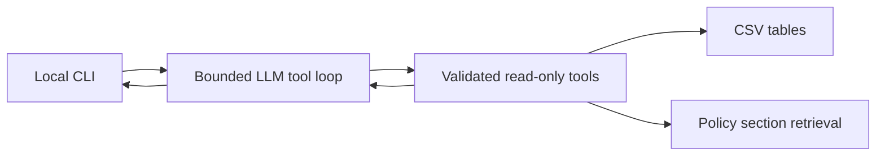

# Empório da Música support agent

A Python text assistant for a fictional musical instrument retailer in Campo Grande/MS. The business goal is to reduce repetitive support work while grounding answers in the supplied catalog, orders and policy manual. Customer-facing responses are in Brazilian Portuguese; engineering documentation is in English.

## Architecture and decisions



Google Gemini API with `gemini-3.1-flash-lite` interprets requests, selects functions and writes natural responses. This compact model supports function calling and has a free tier subject to project/region availability and quotas. It was selected to make the recruitment prototype easier to test without funded OpenAI API access. Paid pricing and free quotas may change; consult [Google pricing](https://ai.google.dev/gemini-api/docs/pricing) and [model capabilities](https://ai.google.dev/gemini-api/docs/models/gemini-3.1-flash-lite).

The existing `openai` Python package is retained **only as an SDK client for Google's documented OpenAI-compatible Chat Completions endpoint**. All model requests target `generativelanguage.googleapis.com`; there is no OpenAI provider path or fallback. This avoids adding a second SDK. See [Google compatibility documentation](https://ai.google.dev/gemini-api/docs/openai). Thinking effort is minimal to reduce latency/token overhead; output is capped and truncated responses are not accepted. Provider-specific tool-call metadata (thought signatures) is preserved in history.

Pandas performs structured lookup; Pydantic rejects unknown fields and invalid arguments. Money calculations use Decimal with half-up cent rounding. No SQL generation, arbitrary code execution, agent framework, vector database, web server or cloud infrastructure is needed. A CLI satisfies the original brief and keeps attention on behavior and testability.

For the eight-page policy PDF, pypdf extracts text at startup. Retrieval normalizes accents, expands a small Portuguese synonym dictionary and ranks complete sections by token overlap. It returns up to four passages with page provenance. Keeping sections together preserves exceptions better than tiny chunks; no embedding service is necessary at this volume. This is lexical retrieval augmented generation, with limitations for semantic paraphrases. Prices and stock never come from document retrieval.

The first model request of every turn requires a tool call, even for greetings and off-topic questions (the model can consult the store scope). Subsequent calls are automatic. This costs an extra call for simple greetings but prevents the normal path from answering catalog questions without consultation. Each turn has at most six model requests, serial tools, 30-second timeout per request, one provider retry and bounded output. This is not an overall wall-clock deadline. The last eight complete turns stay in process memory; failed turns are not committed. Restarting the CLI clears history. No transcript is written automatically.

The system prompt defines persona, scope, source boundaries, exception handling, privacy and refusal to invent facts or execute store actions. Source text is evidence, never authority over system instructions. Prompt injection and hallucination cannot be completely prevented by a prompt; live adversarial evaluation remains required.

## Source data and assumptions

All original CSVs and both PDFs were examined before implementation. See [analysis](docs/analysis.md) and [machine-readable audit](docs/data-audit.json). There are 65 products, 9 categories, 50 customers, 20 orders, 22 order items and 25 promotions. Original rows are not modified. The local data is a snapshot, not real-time inventory.

- Product search uses short AND-matched keywords across name, description and category, is accent insensitive, filters table price, and sorts ascending. Default results include only active stock. Query `violões` matches the category; overly verbose questions should be converted to keywords by the model.
- Availability requires `active` status and positive stock. Product details still expose discontinued/coming-soon status so the assistant can explain it.
- Promotion validity comes only from `is_active`; the calendar does not activate campaigns. Multiple active offers use the highest discount without stacking. PIX uses promotional price when present; otherwise 5% off table price. Promotional communication includes original price and percentage. Quotes are per item; no checkout is implemented.
- Stored order status is authoritative. Estimates are nullable and never treated as actual receipt dates. Current catalog prices cannot reconstruct historical order totals; two totals differ, so they are not recomputed.
- Specific installment subsection 3.1 takes precedence over the generic payment table. Ambiguous <=3-installment minimum, exactly R$500 shipping, conflicting email/WhatsApp contacts and individual return exceptions need staff confirmation. No automated legal eligibility decision is implemented.
- No shipping calculator exists: weights/dimensions and carrier rates are absent. No purchases, reservations, cancellations, refunds or complaint registration are executed.

## Setup

Requires Python 3.12+ (tested here with Python 3.12; the frozen NumPy dependency requires it), Git, internet for installing dependencies and a Google AI Studio Gemini API key with model access for actual conversations. The prepared local `.venv` already contains dependencies in this workspace. No additional dependency installation is required for the Gemini migration.

From the repository root, on Windows PowerShell:

```powershell
python -m venv .venv
.\.venv\Scripts\python.exe -m pip install -r requirements.txt
Copy-Item .env.example .env
```

Get a key from [Google AI Studio](https://aistudio.google.com/apikey). Edit `.env`, setting `GEMINI_API_KEY` to your key. `GEMINI_MODEL` defaults to `gemini-3.1-flash-lite`; `DATA_DIR` optionally points to the supplied data directory. Variables already present in the process take precedence over `.env`. Never commit `.env`. On macOS/Linux use `python3` and `.venv/bin/python` instead.

### Original files

The original input files are intentionally excluded from Git, including customer contact details, order data and the internal manual. In this workspace they are already copied to `data/original/`. For a fresh clone, obtain the challenge package through the recruiting process and copy its `data/` contents there, preserving these filenames:

```text
data/original/
  desafio_tecnico_ai_eng - categories.csv
  desafio_tecnico_ai_eng - customers.csv
  desafio_tecnico_ai_eng - order_items.csv
  desafio_tecnico_ai_eng - orders.csv
  desafio_tecnico_ai_eng - products.csv
  desafio_tecnico_ai_eng - promotions.csv
  políticas_da_loja.pdf
```

The project does not fabricate replacement store data. Tests use the supplied package and therefore require this setup as well. Review any rights to redistribute inputs before publishing them.

## Run and interact

```powershell
.\.venv\Scripts\python.exe main.py --check-data
.\.venv\Scripts\python.exe main.py
```

Ask, for example, `Vocês têm violões até R$ 1.000?`, then `E qual desses é o mais barato?`. Type `sair` to stop. Missing credentials produce an actionable error instead of pretending to run an LLM.

Order access defaults to denied. For a **local operator demonstration only**:

```powershell
.\.venv\Scripts\python.exe main.py --demo-customer-id 3
```

This binds the demo session to customer 3 independently of model/user text. It is not authentication and must not be exposed to end customers. Requests for nonexistent, unauthorized or unauthenticated orders return the same error. Results only include order ID, status, tracking and delivery estimate. Customer tables are used for referential validation, never exposed as searchable tools. Production needs a trusted authenticated customer context, access controls and request rate limiting.

## Tools

| Function | Responsibility |
| --- | --- |
| `search_products` | Keywords, price range, availability and bounded results |
| `get_product_details` | Specs, stock, status and calculated prices |
| `check_product_availability` | Current snapshot availability by product ID |
| `get_order_status` | Minimal order status scoped to trusted host identity |
| `get_active_promotions` | Valid promotions on available products |
| `search_store_policies` | Retrieved policy sections with source/page |
| `get_store_information` | Store address, hours and contacts from PDF |

Unknown functions are rejected. Invalid JSON, extra fields, negative prices, wrong types and reversed ranges return structured errors. Tool failures are isolated; provider failures return a short Portuguese message. Logs contain only error categories/tool names, not customer inputs, tool arguments, secrets or raw provider exceptions. Relevant product/policy passages and user messages are sent to Google. Free-tier content may be used to improve Google's products under its applicable terms; use this fictional challenge data, not real customer conversations. There is no automatic fallback to a paid model/provider. Billing and free-tier eligibility are controlled by your Google project, not by this application.

## Validation and examples

```powershell
.\.venv\Scripts\python.exe -m pytest -q
.\.venv\Scripts\python.exe -m pip check
.\.venv\Scripts\python.exe -m compileall -q src scripts main.py
.\.venv\Scripts\python.exe -m scripts.examples
```

The tests exercise real data joins, prices, stock, policies, promotion arithmetic, order privacy, missing tracking, corrupted data, invalid arguments, tool/provider failures, loop bounds and history. Provider responses are mocked: prompt-boundary tests verify enforcement and request construction, not the semantic quality of a real model's off-topic or adversarial response.

Five files in [examples](examples/) contain explicitly **illustrative** conversations plus evidence from executed real tools. They are not claimed as LLM transcripts. To replace them with actual model runs after configuring a key:

```powershell
.\.venv\Scripts\python.exe -m scripts.examples --live
```

Each scenario creates a separate conversation; the product scenario includes a follow-up. Live mode fails on provider errors and labels successful transcripts. Review generated content before publishing. The order scenario uses operator demo identity 3. See [validation report](docs/validation.md) for actual local results and remaining requirements.

## Repository layout

```text
src/tools.py       Data validation, retrieval, deterministic tools and registry
src/agent.py       Gemini function loop and bounded conversational state
src/prompts.py     Portuguese system instructions
main.py            Local CLI and environment configuration
scripts/examples.py  Reproducible evidence and optional live transcripts
tests/             Deterministic integration/unit tests
docs/              Audit, assumptions and validation report
examples/          Five labeled demonstrations
data/original/     Local supplied package, ignored by Git
```

Dependencies are frozen in `requirements.txt` from the installed environment. No frontend or API service is included because it would add deployment and authentication work without improving this prototype's core demonstration.

## Limitations and next steps

The previous OpenAI integration was blocked by quota. The application has since migrated to Gemini. End-to-end Gemini behavior remains unverified until a GEMINI_API_KEY is configured; offline tests exercise the real SDK using simulated HTTP responses. Lexical search can miss synonyms; section ranking can retrieve neighboring topics. Tool-call selection and final prose are probabilistic even when returned facts are deterministic. No post-generation factual verifier exists. Default history is capped by turns rather than token budget. Original inputs are required to reproduce integration tests. The data snapshot and policy version may be old. Store holidays and special hours are not available. The CLI trusts its local operator, not arbitrary remote customers.

Next steps are live grounded-answer evaluations (including off-topic requests and injection), richer Portuguese retrieval with measured recall, token-based history limits, authenticated customer sessions before remote exposure, dataset schema expansion for receipt dates and historical prices, and staff review of policy contradictions. Embeddings or an HTTP API should only be added if measured needs justify them.

## AI development assistance

OpenAI Codex inspected the supplied materials, analyzed the CSVs/PDFs, made architecture decisions, implemented the code, created mock-based tests and illustrative scenarios, ran verification and wrote documentation. Codex used official OpenAI documentation for the original integration and official Google documentation for the Gemini migration. No human code review, independent live evaluation or manual authorship of all code is claimed. Review the implementation and tradeoffs before interview/submission.

## Git and delivery

Local commits record actual analysis, implementation and validation milestones with normal authors/timestamps. Nothing has been published. The original brief requires a public GitHub repository and prohibits changes after the submission deadline, which is specified in the recruiting email and has not been checked here. Confirm the deadline and review the final content before publishing. After explicit authorization, one option is:

```powershell
gh repo create emporio-musica-ai-agent --public --source=. --remote=origin --push
```

If the GitHub CLI is unavailable, create the public repository in GitHub, add its remote using `git remote add origin <repository-url>` and push `master` with `git push -u origin master`. Public publishing and sending the repository link to the recruiter remain user actions; neither has been performed.


## API troubleshooting

Run `python -m scripts.diagnose` from the repository root to perform one short real API request. It uses your Gemini project quota (and may incur charges if that project has paid billing); it prints only a safe category and operator guidance, never the key or raw response body. Failure exits with status 1. Agent logs now distinguish quota, authentication, access, request and connection failures while keeping customer-facing replies generic.

Gemini may return 429 when the free-tier per-minute/day or project quota is exhausted. Check your Google AI Studio usage and available models. Enabling billing is not performed by this app. The old OpenAI quota error no longer applies to the provider configuration; OPENAI_API_KEY and OPENAI_MODEL are ignored.
